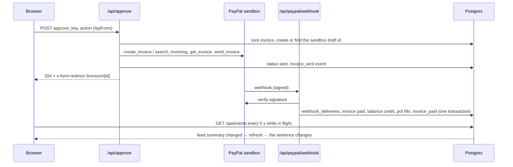
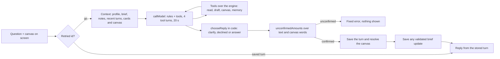

# Architecture: how the app is wired

## What the system is

A Next.js 16 app on Cloudflare Workers (OpenNext) over household-scoped Postgres in Supabase (Tokyo, `ap-northeast-1`, transaction pooler).
Try it and magic-link sessions, Home and invoice review, typed-in data (clients, bills, card charges, pots, people, invoices marked paid),
statement and PayPal history import, the reader (upload, forwarded email, a file attached in Ask), the in-app agent with its canvas and memory,
MCP, the family view, Your data (export, import, delete, this device only), what foreign money costs (D62), PayPal approval and verified-webhook
handling are implemented, along with daily suggestions from the money engine (D64), optional email and push reminders (D65), goals and standing rules (D66), and Keep this? offers in Ask (D67). The local test suites run them on isolated PGlite data with simulated external results. Next.js dev and the local
Worker read a fictional household from the Tokyo project; Vault and the private Storage bucket are verified there. Not yet verified live:
magic-link delivery, a live model call, the deployed Worker, Email Routing, and a real PayPal send-to-webhook round trip. The repository and
the app are private. Decisions: D18, D31–D67 in [DECISIONS.md](DECISIONS.md).

Long biller and client names wrap within their rows on narrow screens, including Home's forecast notes and the To check cards.

## The stack tree

```
Clients
├── Browser (phone and desktop): the Next.js UI; a Try it household or a magic-link session; voice through browser speech (`useSpeech`: Ask, the top and phone bars, Fill by voice)
├── MCP client (Claude Code, ChatGPT…): a bearer token → the same tool catalogue as the agent, read and draft only
├── Email: the person forwards a bill to their address on the owner's domain (`FORWARDING_DOMAIN`)
└── PayPal sandbox: webhooks after an invoice is paid

Cloudflare
├── Email Worker (`worker.ts` `email`): Email Routing hands it each mail → POST /api/inbound with `INBOUND_WORKER_SECRET`; over 6 MiB is rejected
├── Cron Trigger (`worker.ts` `scheduled`): hourly discovery and one self-bound GET /api/cron per household with `CRON_SECRET`
└── Next.js 16 app on Workers (OpenNext adapter); `src/middleware.ts` refreshes the auth cookie on every path except the webhook, cron, MCP and inbound
    ├── Pages (server components): the sidebar is Home /, Ask /canvas, To check /to-check, Activity /activity, Cards /cards, Clients /clients, Plan /plan
    │   ├── /options, /upload, /invoices/new, /invoices/[id], /memory (Profile, Spaces, Goals and Rules), /settings, /account (delete my data), /privacy
    │   ├── /start (Start with my numbers), /login, /onboarding, /join/[token] (D68)
    │   └── /family/[token]: no session; the token resolves to a household (D52); no-store, noindex, no referrer
    ├── API routes (`src/app/api`): mutating routes start with `householdRequest` (`src/lib/session.ts`); answers come from `src/lib/door.ts`
    │   ├── /api/ask               one question in a verified space `{ id, spaceId, text, source, canvas, incognito? }`; body at most 128 KiB, or 512 KiB with device data. Checks answer plain text (400, 401, 403, 429), then the answer streams as `application/x-ndjson` (step lines, then the reply with any Keep this? offers or space proposal, or an error line)
    │   ├── /api/ask/document      POST attaches a file in Ask (multipart: `id`, `conversationId`, `spaceId`, optional `text`, the file); GET `?id=` gives the card again; its failures answer as `/api/upload` does (400 the file or form, 503 a setting missing and named, 502 a service failed, 500 anything else)
    │   ├── /api/ask/thumb         `{ id, thumb }` on one reply; one content-free log line
    │   ├── /api/canvases          pins on Home and in spaces (D57, D69): `kind` pin, update, move or unpin; the recipe is checked with `RecipeSchema`; at most 8
    │   ├── /api/canvas/resolve    a recipe → each block's query through the engine → the resolved blocks; body at most 100,000 bytes; nothing is stored
    │   ├── /api/memory            add, edit, delete or forget all of what the assistant remembers; the page /memory
    │   ├── /api/spaces            POST `kind` create, rename, archive, delete or brief. Same-origin household guard and 20 requests per minute
    │   ├── /api/clients, /api/bills, /api/charges   typed-in client, bill (`kind` add, edit or fill) and card charge ("Paid in another currency", D62)
    │   ├── /api/remove            remove a bill (a repeating bill as a whole series) or a card charge; `kind` and `id`
    │   ├── /api/voice-fill        Fill by voice (D26): `{ text, fields }` → one forced-tool model call on the household's text model → `{ values, heard, notes }` checked by `checkFill`; writes nothing, no rate limit, 16 KiB cap, 503 names the missing AI setting
    │   ├── /api/bank-balance      the one-line bank balance update on Home (D42)
    │   ├── /api/pots, /api/pots/remove   add or edit a pot; remove a pot (the Plan page, D43)
    │   ├── /api/people, /api/settle      Settings → People (add, rename, shares); Mark settled on Home (D45)
    │   ├── /api/family-links      owner creates a family view link (the full link and the LINE message, once) or stops one (D52)
    │   ├── /api/import            Settings → Import a statement (D53): up to 500 CSV rows the browser parsed, for one card
    │   ├── /api/invoices/draft, /api/invoices/paid   an invoice draft; mark an invoice paid outside PayPal
    │   ├── /api/upload            photo or PDF (`readUpload`) → Storage → documents → reader; answers 400 a problem with the person's file, 503 a server setting missing (named in the sentence: the AI model settings, or a Storage setting), 502 Storage failed, 500 anything else
    │   ├── /api/inbound           forwarded email (the Email Worker only) → Storage → documents → reader; 403 with no body for a missing Worker origin or a wrong secret, 503 with no body and one server log line naming the variable when the server lacks a setting it needs, 404 no household, 202 accepted
    │   ├── /api/readings/retry    read a document again
    │   ├── /api/confirm           a reading or a pending row → a bill, a charge, a bank balance or a pot; corrections become rules
    │   ├── /api/approve           the user's tap → PayPal sandbox send or reminder → events (the only place that sends, D12)
    │   ├── /api/paypal/webhook    verify the signature → webhook_deliveries → events → invoice paid; GET: the caller's recent deliveries, no payload
    │   ├── /api/paypal/import     read the sandbox merchant's invoices → clients and invoices (the one household in `PAYPAL_BALANCE_HOUSEHOLD_ID`)
    │   ├── /api/mcp, /api/mcp/tokens   the MCP server (token → household). The owner issues and revokes keys
    │   ├── /api/suggestions       POST `kind` dismiss or not_now for one open finding (D64)
    │   ├── /api/rules            POST `kind` set for one household standing rule with optional space assignment (D66, D69)
    │   ├── /api/reminders        POST per-member settings, subscribe, unsubscribe or test (D65)
    │   ├── /api/events            GET events since a time plus the feed summary; POST mark read (the bell)
    │   ├── /api/try, /api/try/reset, /api/try/blank   Try it (Ben's demo household); demo-only reset; Start with my numbers (D47)
    │   ├── /api/auth/link, /callback, /logout   magic-link request, callback and logout
    │   ├── /api/onboarding        first-run setup for a signed-in person through `createHousehold`; upgrades a Try it or blank demo household
    │   ├── /api/settings, /api/settings/ai-model, /api/forwarding   name and balance, a card (with its foreign fee, D62); Your AI model; forwarding address
    │   ├── /api/invites            owner creates or cancels a link. A verified invitee can accept and a member can leave (D68)
    │   ├── /api/household         delete my data (the signed-in owner, `confirmation=delete`)
    │   ├── /api/export            Export my data: the version 3 snapshot with events, memory, canvases, spaces and journal, as a JSON download (D44)
    │   ├── /api/data              Settings → Your data (D59): `kind` delete_kind, delete_one or delete_conversation
    │   ├── /api/data/move         where memory, canvases and the journal are kept (D59): `step` read, to_device or to_cloud; JSON at most 2 MB
    │   ├── /api/restore           Import (D59, D44): a household snapshot (JSON, at most 1 MB) into a household that has nothing in it yet
    │   ├── /api/cron              lists due households, or runs one with `?household=<id>` (bearer `CRON_SECRET`)
    │   └── /api/health            readiness: setting names and reasons, with separate optional email and push results
    └── Core (pure TypeScript, no I/O)
        ├── Engine `src/lib/money`: runway.ts (availableCash, series, low, safeToSpend, roomOnCard, ladder, timeline, statementItems), repeat, window (`stateThrough`, `dayView`), plan,
        │   split, month, spending, period (the month a bill covers, D63), name-key, categories, categorise, regular, varies, gaps, checks, amount, horizon, whatif, fx-cost (D62), options, ask, to-check, suggest (D64), goals (D66)
        ├── Sentence composer `src/lib/money/sentence.ts`: engine output → "You're fine if … If late, ¥18,780 short on the 27th."
        ├── Agent `src/lib/agent`: one tool catalogue (tools.ts, canvas-tools.ts, memory-tools.ts, check-tools.ts, offer-tools.ts), run.ts, words.ts (the step words), reply.ts, rules.ts, memory-prompt.ts, log.ts
        ├── Model call `src/lib/ai`: `callModel` (Vercel AI SDK core, Anthropic Messages and OpenAI-compatible Chat Completions), `checkBaseUrl`, `unconfirmedAmounts`, `checkConnection`, `PROVIDERS`, the tested list
        ├── Canvas `src/lib/canvas`: the recipe schema, `resolveRecipe`, starters, words, the request helper (D57)
        ├── Memory `src/lib/schema/memory.ts`: the item schema (D58); the household-scoped functions are `src/db/memory.ts`
        ├── Reader `src/lib/reader`: accept, extract, forwarding, storage, settings, correction, document-card, form
        ├── PayPal layer `src/lib/paypal`: sandbox REST client, toolkit wrapper (`runTool`, `sandbox: true`, 20 s timeout), invoice listing, webhook signature check
        ├── Catalogue `src/lib/catalogue` over `src/data/catalogue/jp.json` and `us.json` (secondary, D6); `jp-payout-cost` is its first live move, through `foreign_costs`
        ├── Request log `src/lib/request-log.ts` (`logged`, `routePattern`, `noteHousehold`: the one content-free line per request, D50) and `src/lib/ray.ts` (the `pes-ray` cookie name); `src/middleware.ts` leaves the Cloudflare ray in that cookie on page requests
        ├── Error pages `src/app/error.tsx`, `global-error.tsx`, `not-found.tsx`; `src/components/shell/ErrorReference.tsx` prints "Reference: <ray>" (the error's digest when no ray is known)
        └── Auth and scope: request → user → household_id; every query carries it (`requireHousehold`)

Supabase
├── Postgres (Drizzle, Tokyo region, migrations 0000–0029), 34 tables: households, members, users, paypal_connections, clients, invoices, bills,
│   cards, card_statements, charges, documents, readings, rules, events, webhook_deliveries,
│   api_tokens, family_links, fx_rates, request_buckets, balance_updates, pots, settlements, memories, canvases, conversation_turns,
│   ip_buckets, ai_global_usage, ask_receipts, standing_rules, suggestions, reminder_settings, push_subscriptions, reminders, invites
├── Auth: magic-link login (PKCE), with invited member acceptance bound to the verified email
├── Vault: households' own model keys, each sealed in the Worker first (`AI_KEY_SEAL_KEY`)
└── Storage: the private bucket named by `SUPABASE_DOCUMENT_BUCKET` (`household-documents` in the owner's project): receipt photos, PDFs and raw forwarded emails

Outside
├── Model providers: the server's `AI_` connection (not capped), or a household's own model (a listed provider or an OpenAI-compatible address, key in Vault)
├── PayPal sandbox API (`api-m.sandbox.paypal.com`): send invoice, send reminder, read invoices and the balance; webhooks come back in
├── Resend and browser push services: optional member reminders, one Home link (D65)
└── The ECB daily reference rate (`eurofxref-daily.xml`): the daily job's USD/JPY for real JPY households
```

**The forms.** Forms that post to a route use the client component `src/components/ui/ApiForm.tsx` (upload keeps its own: several files, each posted on its own, one after another, with a line per file). The push controls use the browser Push API before posting their device subscription. The shared form posts with
fetch and the header `x-form-fetch: 1`, shows the route's text answer in its status line when the route refuses (keeping what was typed), refreshes
the page when the route answers 200, and follows the route's redirect when it answers one. A route that redirects takes the request
(`redirectTo(location, request)`, `privateRedirect(location, request)`): to a fetch with the header it answers 204 with `x-form-redirect: <location>`;
to a native post (no JavaScript, the HTTP suites) the 303 it always sent (`src/lib/form-fetch.ts`).

## The loops, as pipelines

### 1. The product loop: open the app, Approve, PayPal, webhook, the sentence changes

| Step | What runs | What is read | What is written | What the person sees |
|---|---|---|---|---|
| 1. Open | page → `currentHouseholdId` (auth cookie → `getUser()` → `users` → `members`; or the demo cookie → `findDemoHousehold`) → `loadWorkspaceData` | `households`; on Home `refreshPayPal` first | on Home `paypal_connections` (PayPal's status word on tracked invoices, `paypal_fetched_at`, the balance for the bound household; never an invoice's own `status`) | the page opening |
| 2. Engine | `loadMoneyState(db, hid, today)` → `src/lib/money` | paypal_connections, bills, cards, charges (the last 62 days, `CHARGE_LOOKBACK_DAYS`), unpaid card_statements, clients, invoices, pending balance_updates, pots, members and settlements (the split), fx_rates (`usdRateMicro`) | nothing | — |
| 3. Sentence | `homeSentence` and the panels | the engine's result | nothing; no AI call on open | the sentence with one action, safe to spend, Coming up, the pinned canvases, the events |
| 4. Approve | tap → `ApiForm` POST /api/approve `{ approve_key, action: send \| remind }` → `approveInvoice` → `runTool` | the invoice by `approve_key` (locked), `SANDBOX_CLIENT_EMAIL`, the USD rate | `invoices.paypal_invoice_id`, `number`, `fx_rate_micro`, then `status = sent`, `sent_on`, `due_on`; an `invoice_sent` event; a reminder stamps `reminder_attempted_at` then `reminded_at` | redirect to /invoices/[id] |
| 5. Webhook | PayPal POST /api/paypal/webhook → `verifyWebhook` → `applyVerifiedDelivery` (`src/lib/events.ts`) | the owning household by `paypal_invoice_id`, the owner's `paypal_connections`, fx_rates when the row has no rate | one transaction: `webhook_deliveries` (unique on `paypal_event_id`), `invoices.status = paid`, `paid_on`, the balance credit, `invoice_paid` with the bell, `pot_filled` rows | nothing yet |
| 6. Update | `useEventFeed` polls GET /api/events | `events`, the feed summary | `events.read_at` when the bell is opened | the sentence changes; the bell counts |



**Open the app, in detail.** The engine reads bills (a confirmed repeating bill, monthly or yearly, is expanded into its occurrences up to the end of
the plan window (30 days, or to the last statement), or stops after its last payment (`repeat_until`), each with the amount that applies on its date, `src/lib/money/repeat.ts`; `MoneyState.storedBills` keeps the stored bills (a repeating bill once), and `stateThrough` / `dayView` (`src/lib/money/window.ts`) expand them to a later day, up to the two-year limit, for the `timeline` tool's `on`, a canvas block's `days` and the checks; a bill's
cancel-by dates become `cancelNotices`, the dated rows Coming up shows next to the occurrences, so `runway.ts` is unchanged), cards, charges,
statements, invoices, clients, pots (cash starts from `availableCash`: bank + PayPal less confirmed pots), and with two or more members the split
(`src/lib/money/split.ts`: shared bills and charges since the last settlement, past monthly occurrences included; it moves no money in the runway).
Home draws, between the sentence with its action and the panels, the household's pinned canvases (at most 8, drawn by the engine with `resolveRecipe`
and no model call: `Pinned.tsx` for cloud pins, `DevicePins.tsx` through `POST /api/canvas/resolve` for pins on this device). Activity, Settings and
Upload only need the owner, the event feed, the timezone and the pending count for their navigation; the count uses the same household and charge
date window as To check. `refreshPayPal` (`src/db/paypal-refresh.ts`, D37) runs on Home at most every 5 minutes behind a persisted lease: it reads
each tracked invoice (draft or sent, with a PayPal id) and, for the household bound by `PAYPAL_BALANCE_HOUSEHOLD_ID`, the balance report; a demo with
nothing tracked makes no call; it never enumerates the merchant's invoices.

**Approve, in detail.** `/api/approve` is behind `householdRequest`, the approvals limit and `env()` (which refuses anything but `SANDBOX`).
`prepareDraft` locks the invoice by its `approve_key` (the idempotency key, D37), requires a positive USD amount and payment on receipt, finds the
sandbox invoice by its number (`P-` plus the id in base64url, `search_invoicing`) or creates it (`create_invoice`, request id `C-<key>`), and commits
`paypal_invoice_id`, `number`, `status = draft` and the day's USD rate before any send, so a webhook can identify the invoice even if the send times
out. `sendInvoice` checks with `get_invoice` that the only recipient is the sandbox test client, sends (`send_invoice`, request id `S-<key>`) when
PayPal still holds a draft, and in the same transaction sets `sent`, `sent_on`, `due_on` and records `invoice_sent`. `remind` commits
`reminder_attempted_at` before the network call (PayPal documents no idempotent retry for it) and `reminded_at` after. Every PayPal call goes through
`runTool` (`src/lib/paypal/toolkit.ts`): `sandbox: true`, a 20 s timeout. The engine finds the low point and ranks the options; the one action on
Home follows the runway’s recommendation. From your assistant also links to any invoice reminder found by the daily pass (D64).

**The webhook, in detail.** A rejected signature writes one `console.warn` with the reason and answers `{ received: false }` 400; an anonymous caller
learns nothing. A verified delivery: the household is found by PayPal's invoice id (never a household id from PayPal); `lockRunway`;
`recordWebhookDelivery` inserts on `paypal_event_id` (a replay stops here; a verified event that matches no household is still recorded with
`household_id` null, so its redelivery is recognised); only `INVOICING.INVOICE.PAID` with status `PAID` goes on (PayPal also emits it for partial and
pending payments). The invoice becomes `paid` with `paid_on` in the household's zone (a Try it household: not before its fixed date or `sent_on`); the
owner's PayPal balance is credited in its own currency at the rate on the row (or the latest `fx_rates` on or before the date, then stored on the
row), skipped when `balance_as_of` is already later; `invoice_paid` is recorded with the bell at PayPal's `create_time`; `fillPots` adds each
confirmed pot's `fill_bp` of the home-currency credit and records `pot_filled`, all in the same transaction (`src/db/pots.ts`); `observeRunway`
compares short and not-short. An invoice marked paid outside PayPal (`/api/invoices/paid`, `markPaidOutside`) credits the bank balance at the latest
rate on or before today and fills the pots the same way; a PayPal-linked invoice is refused there and stays with the webhook (D15); a PayPal import
credits nothing and fills nothing. Local tests inject a simulated PayPal transport and call the database handler with an already-verified event; no
real invoice send or payment has been performed.

**Updates: events, the bell and polling.** Every change is an `events` row. Rows with `notify = true` feed the bell in the top bar (unread count,
list, `read_at`). Home and To check poll the event feed every 5 s only while the feed says something is in flight: a sent invoice with a PayPal id,
or a document queued or being read (`eventFeed`, `src/db/event-feed.ts`). Returning focus checks the feed and refreshes the screen only when its
summary changes. The feed's `since` cursor is the household's latest `occurred_at` from the server, never the browser's clock, and the poller compares
the summary (count, unread, in-flight, cursor), so a change is seen even when an event's time is not after the cursor. `recordEvent` stamps a Try it
household's events on its clock (`householdMoment` in `src/db/clock.ts`: the demo date at the current time of day in the household's zone) and a real
household's at the database's `now()`; an explicit `occurredAt`, such as a provider's payment timestamp, is kept as given. No email, no websockets for
Nov 12; Web Push after.

### 2. The agent loop: Ask and MCP

| Step | What runs | What is read | What is written | What the person sees |
|---|---|---|---|---|
| 1. Question | `AskPage.tsx` (`/canvas?space=<id>`, General by default; the top and phone Ask links open /canvas#ask on Enter or Space, and hand a typed character over in `sessionStorage` `pes-ask-draft`; browser shortcuts keep their usual behavior) → POST /api/ask | the canvas on screen, plus device profile, notes, brief and history when stored locally | nothing | the question in the conversation |
| 2. Gate | `answerQuestion` (`src/db/ask.ts`) | the selected household space; `readPlaces`; `turnById` and `askReceipt` for a retried id (cloud journal); `askReceipt` (device journal) | nothing | a retried id gets its saved reply (cloud journal) or the fixed "already saved" sentence (device journal) |
| 3. Context | `assembleContext` (`src/db/ask.ts`) | rules, profile (6,000 characters), brief (2,000), space notes (3,000), recent turns (12,000), their live document cards, then canvas | nothing | — |
| 4. Model | `runAgent` → `callModel`; `onStep` says `THINKING_WORDS` ("Thinking about your question") before each model call | the assembled context and tool catalogue. `aiConnection(db, hid, "text")` supplies the connection per call | nothing | — |
| 5. Tools | the catalogue over the engine; the read tools of one model turn run together (`callAll`), draft tools alone in the order asked, results in the order asked | the money state, loaded once per tool turn | draft tools: pending rows in To check, an invoice draft, a memory item (`made_by = ask`, `ask_id`) | the latest step in fixed words (`TOOL_WORDS`) in the line under the box |
| 6. Reply kind and brief | `chooseReply` (`reply.ts`) + `unconfirmedAmounts` | the question, its tool results and memory for the answer. Memory source ids are checked in code. A brief update uses amounts only from this question’s tool results | nothing | — |
| 7. Save | after a declined reply `consumeRequest` decides the limit atomically; `saveTurn`; `resolveRecipe` draws the canvas | `loadCanvasContext` | the turn, then the accepted brief. Cloud saves record a content-free `brief_updated` event. Incognito retains only the retry key | the reply, the canvas, "Based on", pins, thumbs and the updated brief. Incognito replies show "Not saved" |



On phones, Ask’s Based on links and question starters, Upload’s To check link, and Plan’s Add a pot summary use CSS pseudo-elements for larger tap areas. The whole label is the tap area for Rules and Reminders checkboxes.

**The stream.** `/api/ask` runs its checks first (same origin, session, body, the per-household limit) and answers a refusal as plain text (400, 401,
403, 429). After them it answers 200 `application/x-ndjson`: a `{"step": "…"}` line each time `runAgent` calls `onStep` (the fixed words in
`src/lib/agent/words.ts`: `THINKING_WORDS`, one `TOOL_WORDS` line per tool, never an amount, argument or result), then one last line, `{"reply": AskReply}` or
`{"error": "…"}` (the sentence a failure carried as a 503 before the stream began). `src/components/ask/read-stream.ts` (`readAskStream`) reads it line
by line; the page shows the latest step in a `role="status"` line under the box and the error where it always showed it. A 401 on any Ask request (the question, attach a bill, a canvas block, the document card) shows "Your session has expired." with a link "Start again from the home page." to `/` (`SessionEnded.tsx`). The To check Retry control posts through `ApiForm`.

**Budgets and limits.** `MAX_TOOL_TURNS` 4, `BUDGET_MS` 20 s shared by every model call of the question, `MAX_TOKENS` 16,000, no retries (every
attempt asks for its own connection); the ask limit is 30 a minute; declined questions are not capped; the read tools of a model turn are raced against the time left of the 20 s (`beforeDeadline` in `run.ts`): past it the question stops with "That took too long while <the step's words>. Try a simpler question." (outcome `budget`), while a write, `clarify` and `out_of_scope` are waited for and a write already done is kept (`savedThenStopped`); a question is 1 to 320 characters; one question makes at most 20 memory changes on a device (`MAX_MEMORY_CHANGES`;
`remember` and `forget` refuse the 21st in words). With no setting for a model, the Ask page names the missing `AI_` setting.

**Context budget (D71).** `assembleContext` assembles Ask context from fixed rules, then profile items up to
6,000 characters, the space brief up to 2,000, and up to 3,000 characters of the newest space notes. The recent
thread is a contiguous suffix up to 12,000 characters. The context states how many earlier turns remain in the
thread and points the model to `search_history`. It includes the live `cardContext` for each document in that suffix, then the canvas on screen. The model
gets its tool catalogue with that context. The same thread can continue after any interval. Amounts from earlier
turns, the brief, document card text and history search results are read again from current tools before being used in an answer.

**Model tool payload.** The 38 definitions share the runtime Zod schemas. The model-facing form keeps fields and types, with compact descriptions and bulk item guidance on the matching single-item tool. `db:ai-test` checks the 25,000-character budget and the bulk field sets.

**The tools (one catalogue, `src/lib/agent/tools.ts`).** Read tools return the engine’s numbers and relevant context: `where_am_i`, `whats_due`, `open_gaps`, `can_i_spend`, `list_clients_and_cards`, `timeline`, `options_when_short`, `list_invoices`,
`household_snapshot`, `plan_for`, `who_owes_whom`, `month_by_category`, `search_spending`, `bills_for_month`, `regular_costs`, `foreign_costs`, `what_if`, `make_canvas`,
`recall`, `search_history`, `list_spaces`, `to_check`. `bills_for_month` (input `{ month, text }`, D63) lists the stored bills, confirmed or waiting in To check, past or due later up to two years ahead, whose period overlaps the month ("November's electricity" is the bill that says 11月分, though it is paid in December): `billsForMonth` in `src/lib/money/period.ts` builds the summary in code and the totals per currency, `loadPeriodBills` in `src/db/spending.ts` reads the rows, and its note says a bill with no period counts by its due date and points to `month_by_category`; its step words are "Finding the bills for that month" and its "Based on" source is Plan. `what_if` runs the engine on a copy of the household (`src/lib/money/whatif.ts`), so nothing is written. `make_canvas` takes a
recipe as JSON text, checks it, has the engine fill it and returns a summary; the last valid recipe of the question becomes the reply's canvas (a
note's `by` is forced to the assistant). `household_snapshot` gives the whole household as one JSON document for context (the most recent 100 rows of
each long list, `SNAPSHOT_TOOL_WINDOW`; no events, no secrets). `list_clients_and_cards` and `list_invoices` return each client's usual and slowest
days to pay. `foreign_costs` (D62, no input) returns the last twelve months of what foreign money cost: `foreignCosts` in `src/db/fx-cost.ts`
(`foreignCostInputs` loads paid USD invoices, charges with an original amount, the cards and the household's rate history in one read-only
transaction) over the pure engine `src/lib/money/fx-cost.ts` (`PAYPAL_RATES`, `rateOn`, `payoutFeesUsd`, `foreignCosts`, `foreignCostWords`): per
client, PayPal Japan's receive fees and the 3% conversion markup at the rate on the invoice row; per card, each charge's cost above the reference rate
of its date, exact when the issuer's billed amount is known, estimated from `cards.foreign_fee_bp` when `charges.fx_estimated` is true, else unknown;
with the words of the catalogue move `jp-payout-cost` (`src/data/catalogue/jp.json`) as its guidance and /clients as its "Based on" source. Draft
tools (`draft_invoice`, `add_bill`, `add_bills`, `log_charge`, `log_charges`, `update_bank_balance`, `add_pot`, `remember`, `forget`; the plural tools
take 1–10 items in one transaction) save an invoice draft, a pending row in To check or a memory item, and the answer links to it; the user confirms
bills and charges there. `log_charge` and `log_charges` take optional `original_amount` and `original_currency` (D62). `add_bill` takes `repeat`,
`next_amount`, `next_amount_from`, `cancel_by`, `repeat_until`, `category` and `business_bp` (and a null amount or date for a bill not known yet,
D55) through the same `insertBill` as the form; a missing category is guessed from the name. `clarify` and `out_of_scope` have scope `ask`: they end
the question, and when one is asked for and valid it is the only call that runs. An invalid tool input comes back as "Invalid input for this tool: "
plus the failing field paths, never the values; an `InputError` written for a person is relayed. Tool output and remembered text are treated as data.
Every row a draft tool writes carries `made_by` (`ask` with the question's `ask_id`, or `mcp`): To check and Activity say "Drafted by Ask" or
"Drafted through MCP", and the Memory page says "Said in Ask", "Added here" or "Through MCP". Nothing is sent or paid by the agent.

**Code chooses the reply.** The model never picks the reply kind: `chooseReply` does, after the loop. `clarify` gives a clarifying question with
2–4 choices the person can tap; `out_of_scope` (or a plain text with no tool called) gives a decline, the fixed sentence for off-topic or for
investment, tax-filing and legal questions; anything else is an answer, which needs at least one tool and passes `unconfirmedAmounts`
(`src/lib/ai/number-check.ts`) over the answer text and every label, note and letter on its canvas, with the question, this question's tool results
and the memory block as sources (never an earlier reply, and never the echo of `remember`, `forget` or `make_canvas`). A failed check, or a budget,
turn, cut-off, refusal, empty or API failure, shows a fixed sentence. **After a write tool succeeded** in the question, any `AgentError` carries what
was kept (`saved`: `pending` and the links) and `answerQuestion` turns it into an answer: `FIXED.savedThenStopped` plus the error's sentence, the
links (To check, the invoice draft, Memory), stored as a turn like any other, so a retry does not write twice; the log line keeps the real outcome.
**A retried id** (the browser resent a question after a lost response): a question whose `id` is already a stored turn of the household returns that
turn through `turnById` with its canvas drawn again, no model call and no changes, and `links` and `pending` as the first reply had them, read from its receipt; the same id with other words is refused. A household that keeps its conversations on the device (D59) has no stored turn, so `run.ts` calls `onWrote` after the first draft tool succeeds (a `remember` or `forget` on a device memory does not: its change travels in the reply) and `noteAskWrote` (`src/db/ask-receipts.ts`) keeps a receipt first. `ask_receipts` holds (household_id, ask_id, pending, links, created_at); the links are fixed words and app paths, never the question or answer. `noteAskReply` writes `pending` and `links` after the reply, for both cloud- and device-journal replies, when the reply has a To check flag or links; a retry with that id finds the receipt through `askReceipt` and gets `FIXED.alreadySaved` ("This question already saved what you told me. Open To check to see it.") with a link to To check, no model call and no write.

**Spaces and threads (D69).** Migration 0030 adds `spaces`, the nullable household-and-space foreign keys on
`memories`, `canvases`, `standing_rules` and `reminders`, and the trigram indexes on turn questions, turn replies
and memory text. The migration backfills one permanent General per household and a household-insert trigger
creates it for new households. The app bootstrap also ensures it exists. The space id becomes the conversation id
for questions and attachments. Ask verifies the selected space within the household before accepting new turns.
General lists legacy conversations separately as read-only threads. Space navigation in Ask lists open spaces.
Memory → Spaces creates and renames spaces, archives them, and confirms deletion. The household can keep up to 20
spaces open, including General. Archived spaces keep their content and can be opened read-only or deleted from
Archived spaces in Memory. Each space row can show the first line of its brief. Deleting a space clears the space, its thread, notes and pins in one transaction.
Attached documents stay in the household, and rules and reminder history lose their space link. Cloud pins are scoped to their space.
Home draws General and legacy pins. A task space lists its own pins under "Pinned in this space".

**Space proposals (D69).** `list_spaces` in `src/lib/agent/space-tools.ts` reads the household’s space ids, names and statuses in Ask and MCP. Ask’s `open_space`
proposes a name for a new task. It returns an ephemeral "Open space '<name>'?" card. Open space submits the
usual create form to `/api/spaces` and navigates to the created space. Not now dismisses the card.

**Incognito (D71).** The Ask switch sends `incognito: true`. Ask loads the same space context for this question.
The tool catalogue for the question allows read-only behavior. The only saved Ask data is the receipt’s retry key.
A retry returns a fixed sentence explaining that the reply was never saved. The answer shows "Not saved" in the current view. It stays out of the cloud and device journals. The brief and
notes keep their saved state. The temporary canvas is a preview. The saved canvas returns when Incognito is off.
The household’s configured provider still receives the question and context.

**The brief (D69).** `BriefSchema` in `src/lib/agent/brief.ts` describes About, Goal, State with a tool name or note id per line,
Decisions, Open questions, Check next, and lists of bill, client, pot and document ids. It allows up to 2,000
characters of serialized JSON and refuses a run of 12 or more digits in brief text. `briefContext` quotes the saved brief for the next question.
The Ask-only `update_brief` tool proposes a replacement when an answer changes what the space knows. It writes
nothing during tool execution. Code checks the proposed amounts against this question’s tool results. The brief
is applied after the answer’s turn. Cloud saves put both in one transaction and record `brief_updated` in
Activity without the brief text. Device saves carry the accepted brief back to the browser. A rejected proposal
leaves the previous brief in place. Ask shows the Space brief with "Agent updated it" or "You updated it" and the time. Edit opens the structured
fields, with each State line entered as `source | detail`. A cloud save posts `kind=brief` to `/api/spaces` and renders the committed record from the response before refreshing the page.

**The turn and the page.** The turn (question, kind, reply, choices, recipe, sources) is stored in `conversation_turns`
(`src/db/conversation.ts`) and a thread keeps its turns until deletion; the reply carries kind, text, choices, the canvas the engine drew, "Based on" sources from the tools and the individual profile items and space notes the model cited,
links, `pending`, the first-use line (`firstUse(host)`, shown until the household's first answer, D60), `memoryChanges` and `wait`. The page shows
"Pin to Home" in General or "Pin to this space" in a task space (saves through `/api/canvases` for cloud pins), and two thumb buttons (`/api/ask/thumb`, a content-free line with the ids and the thumb).
Each Ask writes one content-free JSON line to standard output (`src/lib/agent/log.ts`: household id, `ask_id`, source, reply kind, whether it had a
canvas, last stop reason, model calls, tool names with ok and milliseconds, outcome, total milliseconds, input and output tokens, protocol and whether
the model was the household's own; never the question, answer, arguments, results or key).

**The canvas (D57).** A recipe (`src/lib/canvas/schema.ts`, version 1) is a title, an optional what-if scenario (steps: add_cost, add_income,
change_bill, remove_bill, client_late) and 1 to 12 blocks that each hold a query, never a number: `sentence`; `number` (safe_to_spend, cash,
low_point, month_total or foreign_costs); `flow_chart` (flow); `timeline` (events); `table` (events, month_by_category, compare_months, spending_search,
regular_costs, foreign_costs or bills_for_month); `compare` (compare_months); `progress` (safe_to_spend, cash or month_total against the person's own target); `note` (by you or the
assistant); `letter`; `sliders` (a client's late days on the recipe's scenario); `action` (a link inside the app, never an outside address or an
/api/ path). `resolveRecipe` runs every query through the engine on the household's state. A `flow_chart` or `timeline` block may carry `mark`, a
stored bill's id: the chart rings the first day that bill falls on in the window (label like "Rent ¥82,000 · Nov 27", added to the aria text as
"Marked: …") and the timeline rows of that bill get `marked` and read "This bill"; a bill not in the window (repeating bills exist only inside the
plan window, about 30 days) draws no mark. A `flow_chart` or `events` block expands the state through its `days`. A `foreign_costs` block (D62) shows the total cost ("about" when estimated) as a number, or a row per client and per card, then Total, as a table; `loadCanvasContext` (`request.ts`) loads the foreign-cost inputs only when `asksForeignCosts(recipe)`, and it has no starter. A `bills_for_month` table (D63) lists the bills whose period overlaps the month, a row per bill and per-currency totals, with the same note as the tool; `loadCanvasContext` loads `periodBills` only when `asksPeriodBills(recipe)`. A `{ q: "goals" }` progress block (D66) reads confirmed dated pots from the current money state and shows each goal’s amounts, deadline and pace. The recipe holds only the query, so a Home pin reflects later pot edits.

**Profile and space notes (D58, D70).** `MemoryItem`s keep the kind, text, source and dates. A household can keep
200 items total, each up to 400 characters. A null `space_id` puts an item in the profile, which is available in every space.
A note’s `space_id` limits its automatic context to that space. The Profile tab and the selected space’s note editor show
the saved items. Profile’s Forget everything clears the profile. Forget space notes clears the selected space’s notes.
Your data can delete the entire memory category. `recall` reads the profile or a named space. An explicit `remember` or a confirmed Keep this? memory
offer goes to the current space unless the person says it is standing information, such as "always" or "from now on".
Standing information goes to the profile. The To check card’s "Also tell the assistant" box saves a profile correction
with the confirmation. Cloud writes use `src/db/memory.ts` under the household role and emit content-free Activity events.

**History and sources (D70).** The read tool `search_history` in Ask and MCP accepts `{ text, space? }`, with an optional
space name or id. `src/db/history.ts` searches the household’s turn questions, replies and memory text for a literal
substring, including English and Japanese. The trigram indexes from 0030 support the database search. It returns up to
ten newest matches with their dates, space names and matching lines. Results are context for choosing current read tools.
The model cites an individual note or profile item with `[[memory:<id>]]`. `run.ts` checks the id against the memory the
model saw in context or through a memory read, removes the marker from the display text, and stores a
`{ kind: "memory", id, label }` turn source for Based on. A visible item links to its note or profile entry. A cloud journal stores a neutral label for a device-memory citation. The browser that holds the item can display its text.

**When memory or the journal is kept on this device (D59).** The browser sends the profile and scoped notes when memory
is local. For a local journal it sends the selected space’s brief and recent turns and a newest-first search window with
up to 64 KiB of serialized history entries. `search_history` searches the device history present in the request. The server
uses the device data for that question and leaves storage to the browser. Local memory changes return as `memoryChanges`.
The browser saves its turn, accepted brief and thumb. MCP sees cloud-held data, and device-held text is available only
to Ask requests from the device.

**How MCP differs.** An MCP client presents a bearer token → `authenticateMcpToken` (`api_tokens`, hashed) → household; the same-origin check applies
when an Origin header is present; the limit is 30 a minute. `mcpRequest` (`src/lib/mcp/server.ts`) builds a stateless SDK server per request with
`MODEL_RULES` as its `instructions` and registers tools eligible for MCP. Draft tools require the
`draft` scope. Read tools include where am I, what’s due, `what_if`, `make_canvas` for a text summary, `recall`,
`search_history`, `list_spaces` and `foreign_costs`. Draft tokens can also draft an invoice, remember or forget. Rows it writes carry `made_by = mcp`. Each tool call writes the same kind of content-free
log line. There is no conversation, no canvas drawing and no reply chooser; sending still needs the tap in the app.

### 3. The reader loop: a bill arrives

| Step | What runs | What is read | What is written | What the person sees |
|---|---|---|---|---|
| 1. In | /api/upload (`readUpload`), /api/inbound (the Email Worker), /api/ask/document ("Attach a bill") | the file: JPEG, PNG, WebP or PDF (magic bytes checked), or the raw email; 1 byte to 6 MiB | — | To check, or the card under the turn in Ask |
| 2. Store | `storeDocument` (`src/db/reader-job.ts`) | — | the object at `<household>/<document id>` in the private bucket; a `documents` row (`queued`); `document_queued` | — |
| 3. Read | `after()` → `readDocumentInBackground` → `readDocument` → `extractDocument` | the object; the household's cards and currency; `aiConnection(db, hid, need)` | `documents.status` reading → read or failed (with the reason, `document_failed` with the bell) | — |
| 4. Propose | `proposeReadings` | `rules` by `kind:normalised name` | a `readings` row per item (`original`, `proposed`, `to_check`); a `to_check` event with the bell | the To check row and the review card |
| 5. Checks | `checksFor` (D61) | the reading against the money state and the other waiting readings | nothing | the failed checks on the card, one question at a time |

```mermaid
flowchart LR
    U[Upload / forwarded email / attached in Ask] --> S[storeDocument: Storage object + documents row]
    S --> R[after the response: readDocument]
    R --> M[document model via aiConnection]
    M --> Z[zod extractSchema: null for anything missing]
    Z --> P[proposeReadings: rules patch, readings rows, to_check event]
    P --> C[checksFor in code: missing, already_saved, past_due, far_from_usual, repeat_unknown]
    C --> V[To check row or the Ask card]
    V --> F[Confirm → reviewReading: bill or charge, rule, memory correction]
    F --> E[Engine recomputes the sentence and suggestions]
```

| 6. Confirm | `ReaderReview.tsx` / `DocumentCard.tsx` (shared `ReadingForm.tsx`) → POST /api/confirm `kind=reading` → `reviewReading` | the reading (locked), the document's kind | a `bills` or `charges` row; a `rules` upsert on a correction; a memory item with the tick; `readings.extracted.confirmed` and `targetId`; `<kind>_confirmed` | the engine recomputes the sentence and suggestions |



**In, in detail.** `/api/upload` and `/api/ask/document` check the file with `readUpload` (`src/lib/reader/accept.ts`): one of `image/jpeg`,
`image/png`, `image/webp`, `application/pdf`, its header matching (`matchesFileType`), at most 6 MiB (`MAX_DOCUMENT_BYTES`). `/api/inbound` accepts
only the Email Worker: origin `https://worker.internal`, `INBOUND_WORKER_SECRET` compared in constant time, and the envelope recipient's 64-character
local part on `FORWARDING_DOMAIN` resolved to a household (`householdForRecipient`); unknown addresses get 404 and the Worker rejects the mail. The
four entry points have no per-minute limit; a file is guarded by its size, the storage cap, the session or the Worker secret, and the digest below. The document id is a content digest of household, media type and bytes (`contentId`), so a
redelivered email or a double upload is one document; a `failed` placeholder row is reserved before Storage is touched, so even an interrupted
upload is removable with the household.

**Read, in detail.** `readDocument` claims the row (`reading`, `processing_at`, a 90 s lease so a stale claim can be retaken), downloads the object and calls `extractDocument` (`src/lib/reader/extract.ts`). A file goes to the model as
uploaded (no server-side image or PDF processing, D32). An email is parsed with `postal-mime`: subject, date and body (text or HTML, at most 100,000
characters) plus up to 8 supported attachments. A body alone needs the text model. Anything with a file needs the document model. Before checking the tool reply against `extractSchema`, the reader drops fields outside the extraction schema, clears invalid categories and invalid calendar dates, and converts digit strings in `amountMinor` to numbers. The schema still requires a positive safe integer or null for an amount and allows at most 12 items. A remaining failure names the invalid field paths, for example `items.0.amountMinor`, without returning model values. The review card sets business share and repeat fields. A bill may also carry `periodStart` and `periodEnd`, which the model fills only when the document prints the month or dates it covers ("11月分" is the whole month); a period with one end, or backwards, is dropped from the reading, and `dateBasis` is set by code and never by the model. `proposeReadings` then gives a bill that has a period and no date an estimated one (`estimatedDue`, `src/lib/money/period.ts`): the household's usual due day for that biller (`usualDueDay`: the latest confirmed bill with the same `nameKey`, its repeat day or due day) in the month after the period, a day the month lacks falling on its last day, else the last day of that month. The proposal holds that date and its words ("Estimated from 11月分: usually paid on the 27th", or "…: no usual day is known, so the last day of the next month"); `original` keeps no date. The review form (`ReadingForm.tsx`) shows the words with "Check the date or type the day." and a "Month this bill covers" pair of dates; confirming writes `bills.period_start` and `period_end` (a one-sided period, a card charge or a repeating bill with one is refused). The period is information only: the engine counts the bill on its due date, while the month view and `search_spending` name the month ("for 11月分"). A charge
read in another currency is stored with its original amount and currency, the billed amount converted at the reference rate, and
`charges.fx_estimated` true (D62), so `foreign_costs` estimates its cost from the card's fee instead of calling the conversion exact. No item found
records `document_read` ("No bill or card charge found"); `/api/readings/retry` reads a failed document again. A stored rule (`rules.match_biller`,
keyed by kind and the normalised name, D36) patches name, kind, category, business share and card before the reading is shown; the review card shows
the Category select and the Business share control.

**Checks and confirm, in detail.** The checks of D61 (`checksFor`, `src/lib/money/checks.ts`: missing, already_saved, past_due, far_from_usual,
repeat_unknown) run on every reading and show on its card and in its To check row. A price-rise check uses the name of the matched regular cost (D54). `reviewReading` runs in one transaction under `lockRunway`: a
reject marks the reading `rejected` (`reading_rejected`); a confirm writes a `bills` row (or `charges` for a card email, through the statement-charge
lock), with a null amount or date when the user says it is not known yet (D55), links a one-off to its amount-varies series (`linkToSeries`, D54),
upserts the `rules` row when the name, category, work share or card was changed, and with the ticked box "Also tell the assistant: …" saves the
correction as a memory item too. The To check card keeps answers by reading id. It fills Repeats and the date or checks the selected unknown fields in the shared `ReadingForm`, and posts the answered check kinds. To check accepts a confirmed form with unanswered checks. `readings.extracted` gets `confirmed` and the saved row’s id as `targetId`. The transaction refreshes suggestions after the save. **A file attached in Ask (D61).**
"Attach a bill" (one or several files, each posted on its own, one after another, each its own turn and card) posts the file to `/api/ask/document`, which stores it as a document of kind `upload` (the same file is one document), saves a
`document` turn (question "Here's my bill" or what was typed, reply "Got your file. Nothing is added until you confirm.", `documentId`) and schedules
the read after the response. The page draws `DocumentCard` under the turn and asks `GET /api/ask/document?id=` every 2 seconds while the tab is
visible (after 60 seconds it says the file will be waiting in To check). `documentCard` (`src/db/document-card.ts`) builds the card in code with
`buildCard`: reading, failed with the reader's own words, or each reading of the document with its read line and its failed checks, shown one
question at a time, then Confirm, Edit and Don't add it. Confirm posts to `/api/confirm` with `from=ask` and `answered` (the check kinds the person
answered); `reviewReading` refuses while a check the card asked is not answered, and `returnTo` sends the page back to Ask. After Confirm the card
carries a canvas from `documentCanvas` (the sentence, the cash-flow chart and the timeline, each resolved by the engine, the bill ringed through
`mark`), drawn each time the card is built, with no model call. The conversation context for later questions holds the card as text (`cardContext`,
never an amount source). Deleting a document in Your data removes its object, its readings and the row; bills and charges made from it stay and lose
the link.

### 4. Typed in, or imported

**The forms.** A client, a bill and a card charge post to `/api/clients`, `/api/bills` and `/api/charges`; each writes a confirmed row and an event,
and the engine recomputes. A bill is one row with a Repeat choice (D41): `repeat_unit` `month` (the due date's day in `repeat_day`) or `year` (the
due date's month and day, 29 Feb on the 28th in a common year) or null for a one-off, an optional `next_amount_minor` from `next_amount_from`, an
optional `cancel_by` that is information only, and `repeat_until` for the last payment; `checkSchedule` in `src/db/bills.ts` refuses a schedule that
does not hang together, and the reader's review card and `add_bill` take the same fields. Every bill and charge carries a `category` key and a
`business_bp` share (D46): the forms post `category`, `businessShare` and `businessPercent`, the routes refuse a key outside the list with 400, and the
agent's tools guess the category from the name when none is given. `fillGap` (`src/db/bills.ts`, `kind=fill`) sets only the missing amount or date
of a bill and records an event with the old estimate; the bill waits in To check and repeats only once confirmed (D55). A charge goes through the
statement-charge lock. **Paid in another currency (D62):** the charge form (`AddEntry.tsx`) and `/api/charges` post `originalAmount` and
`originalCurrency` into `chargeInput` (both or neither); `insertCharge` keeps `amount` as what the issuer billed and stores `original_amount_minor`,
`original_currency` and the issuer's own rate in `fx_rate_micro`, with `fx_estimated` false; Settings → Cards posts a "Foreign transaction fee"
(`/api/settings`, `kind` card, `foreignFee`: 0 to 10 percent, turned into basis points by `foreignFeeBp` in `src/db/settings.ts`) into
`cards.foreign_fee_bp`, null when not entered. Every typed amount is read by `src/lib/money/amount.ts` (thousands separators, full-width digits, at
most ¥100,000,000 or $1,000,000) in the amount boxes and in `parseMinor`, and a bill or charge date may be at most two years after the household's
today (`src/lib/money/horizon.ts`).

**Balance, pots, people, removal.** Home's one-line bank balance form posts to `/api/bank-balance` (`setBankBalance` writes
`households.bank_balance_minor` and a `bank_balance` event with the old and new values; Settings' balance edit calls the same function; the agent's
`update_bank_balance` makes a pending `balance_updates` row that To check shows as "Bank balance → ¥X" and `confirmPending` applies through the same
path). Pots (D43): the Plan page posts to `/api/pots` (`savePot` creates or edits a confirmed pot and records `pot_added` or `pot_updated` with old
and new values) and `/api/pots/remove` (`removePot`); the agent's `add_pot` makes a pending pot that To check shows as "New pot: Car, ¥1,200,000 by
Mar 2027" and `confirmPending` confirms; the engine starts the runway from `availableCash` (bank + PayPal less confirmed pots) so every number
agrees. People and settlement (D45): `/api/people` adds, renames and sets shares; `/api/settle` records a transfer in `settlements`. A bill or a
card charge is removed through `/api/remove` (`removeBill`, `removeCharge`: deleted by id inside the household, a `bill_removed` or
`charge_removed` event, and a confirmed charge is taken back out of the stored statement of its cycle). `confirmPending` (`src/db/confirm.ts`)
confirms the agent's pending bill, charge, balance or pot from To check.

**Goal pace (D66).** Plan and the Goals tab at `/memory?tab=goals` use `goalPace` over confirmed pots with a target amount and date. The pot’s creation date in the household time zone anchors the pace. Try it stamps new pots on its fixed day. The calculation uses whole minor units for the amount expected by today, the difference from actual saving and the monthly amount remaining. A date at the observed pace needs both elapsed days and some savings. The same calculation serves the `goal_behind` finding, the `goals` read tool in Ask and MCP and the canvas progress query. The Goals tab links each pot to `/plan#pot-<id>`.

**Standing rules (D66).** Memory → Rules shows the six rule kinds, their on or off state and their thresholds in words. The tab and Ask’s rule offers both post to `/api/rules`. That route uses the household session and a 20-per-minute limit. New thresholds are 1–30 days, 1–100 percent, or a positive amount within the home currency’s limits. A nudge threshold copied from before migration 0028 can still be read or turned off at its old value. Re-enabling it requires a value in range. Each actual change records a `rule_changed` event. The next suggestion pass reads `standing_rules` through `src/db/rules.ts`. Reader corrections are stored separately in `rules`. A read of an empty rule set locks the household, rechecks it, seeds the normal defaults and records one `rules_initialized` event. A partial set raises an error.

**A statement CSV (D53).** The browser reads the file (`src/lib/import/csv.ts`, at most 1 MB: UTF-8 or Shift_JIS, the header found, the date, name
and amount columns guessed from their words and changeable, each row a charge, a skipped credit or an unreadable row with the reason) and posts JSON
rows (date, merchant, amount, category) to `/api/import`, 500 rows a post, for one card; `importCharges` checks every row again, skips a row already
on that card (same date, amount, name), inserts the rest `made_by = import` and records one `charges_imported` event; stored card statements are
left alone (the issuer's total already counts them).

**PayPal history.** `/api/paypal/import` lets the one non-demo household named by `PAYPAL_BALANCE_HOUSEHOLD_ID` read its sandbox merchant invoices
(`readMerchantInvoices`, read-only, up to 5 pages of 100), match clients by email and add them idempotently on `paypal_invoice_id`; any other
household is refused; already-paid invoices credit no balance.

### 5. The daily loop

| Step | What runs | What is read | What is written |
|---|---|---|---|
| 1. Trigger | Hourly Cron Trigger → GET /api/cron, then one GET /api/cron?household=<id> per result through the Worker’s self binding | The bearer CRON_SECRET is compared in constant time on both requests | worker.ts logs the batch counts |
| 2. Discovery housekeeping | sweepDemoHouseholds (D49), then pruneIpBuckets | Demo households unchanged for seven days, oldest first, up to 200. Per-address windows over a day old | Each demo is deleted in its own transaction. Vault and Storage are cleared before the household row. Sweeper failures are counted and logged |
| 3. Households | dueHouseholds, then runDaily in a separate Worker invocation per household | Non-demo households with a local hour at or after the earliest member hour, including the owner’s hour (08:00 by default), and daily_ran_on before the local date or unset. Least recently served first | runDaily locks the household and advances daily_ran_on only after a successful pass. A failure logs the household id and the error name and message with database details removed. The remaining requests still run |
| 4. Rate and statements | fetchReferenceRate for real JPY households. closingOnOrAfter and cycle for cards | The ECB daily XML and each card closing today with an open total. On a fetch failure the job logs the outage and uses the latest dated rate already stored for the household | One dated fx_rates row when fetched and one card_statements row per card and closing day. These commit before suggestions so a failed pass can retry |
| 5. Suggestions | runPass, rulesFor, findSuggestions | Money state and standing rules with their space assignments | New findings, current reasons for open findings, resolved findings and reopened deferrals. Closed rows are pruned after 90 days |
| 6. Reminders | runReminders, then remindersDue in the shared selector on later hourly invocations | New eligible suggestions still open, members whose local hour has arrived, and their channels and quiet days. Up to 30 households across the pass and delivery work per hourly trigger, leaving room for discovery and the trigger within Cloudflare’s 32-invocation limit | Each member’s channel day is claimed before a send. A delivery row records sent or failed. A gone push endpoint is removed. Delivery rows older than 30 days are pruned |
| 7. Retention | pruneAskReceipts and removeExpiredFiles | The household’s receipts over a day old and raw documents whose readings were all confirmed or dismissed at least 30 days ago | Receipts removed. Raw files removed from Storage and marked on the document row |

Try it and Reset also run the suggestion pass on Ben’s fixed date after the demo record commits. The pass calls no model. Home shows findings by urgency and its review links open existing invoice, To check, bill, card and Plan screens. The approve, confirm, bill and pot write flows close the finding they complete in the same database transaction. Suggestion activity keeps a stable finding reference so pruning cannot produce a duplicate. Ask and MCP share the read tool suggestions. A rule has one canonical row per household and kind. Assigning it to a space changes how its findings are labelled. Memory → Rules names the assigned space. The trigger still uses the household money state. Home groups findings by space when more than one group is present. General includes unassigned findings. The daily digest includes space labels on relevant lines, uses bounded engine amounts, and sends at most one digest per local day for each member and channel. The outgoing labels are bounded and use plain words so the Home link at APP_URL stays the only link. The delivery row links to a space when all eligible findings share that space. Each member can request a fixed test message from Settings. The test reaches their verified sign-in email or their enrolled browser. In Try it, push can be enrolled and tested on the device; the demo date remains fixed.

**Immediate suggestions (29F).** Saving a confirmed bill, charge or pot, filling a confirmed bill’s missing amount or date, confirming a draft or reading, applying a verified PayPal payment and marking a payment outside PayPal all call `refreshSuggestions` after committing the record and any resulting pot credits. The helper runs `runPass` in its own transaction. A completed action closes its matching suggestion as approved in the write transaction. A refresh failure produces one content-free `suggestion_pass` log line with the household id, call site and error and the write still succeeds. The pass reads the new state to create or resolve findings and leaves the delivery schedule with the hourly job. The immediate path uses the money engine alone.

observeRunway runs before and after, so a change from short to fine or back is recorded. A late charge confirmation and statement closing share the household lock, which keeps the charge counted once. Confirmed charges after a card’s latest stored statement are grouped by their closing cycle.

**Keep this? (D67).** The Ask-only offer_keep tool collects up to three distinct proposals for a memory, a dated goal pot or a fixed rule. Code checks the proposed text and amounts and excludes items the household already keeps. The streamed answer carries the offers. They are transient in the current conversation view. Keep uses `/api/memory`, `/api/pots` or `/api/rules`. Memory offers target the current space or the profile according to the person’s wording. The device operation applies the same scope when memory is local. Keeping a rule in a named space assigns the existing rule kind to that space. No dismisses the card in the view.

## Data: where it lives and how it is shared

The five D59 kinds are record, memory, canvases, journal and documents. `DATA_KINDS` in `src/db/data-kinds.ts` also includes reminder history and push subscriptions for counts and deletion in Your data (D65).

Under Uploaded documents, `listDocuments` returns each household document's date, size and first waiting reading, newest documents first. Uploads use the first confirmed reading name, then the first proposed name, then a file-type label. The app does not store original filenames. Forwarded emails use a fixed label. The individual Remove posts `delete_one` to `/api/data`, and `storedBytes` shows the current total against the household's 20 MB Try it or 200 MB signed-in cap. A row whose raw file aged out shows that the file was removed and contributes no bytes to the total.

| Kind of data | Where it is stored | What scopes it | Who can read it | How it leaves |
|---|---|---|---|---|
| The household row: name, time zone, currency, bank balance, demo flag and fixed date, forwarding local part, daily run date, `split_since`, the three places, the `ai_*` connection columns | `households` | its id | the signed-in members and a Try it cookie; the family link viewer sees the sentence; the export carries name, currency, time zone, balance and today | Delete everything (`/account` → `/api/household`), Reset, the demo sweep; Import keeps the household's own name, zone, currency and rate |
| The record (a one-off bill also holds `period_start` and `period_end`, the month it covers, D63): `members`, `clients`, `invoices`, `bills`, `cards`, `card_statements`, `charges`, `pots`, `settlements`, `balance_updates` | their tables | `household_id` (every foreign key is a `(household_id, id)` pair, so another household's row cannot be referenced) | members and Try it; an MCP token (the read tools); the family link viewer (shared bills, the month, who owes whom, no actions); the export; the `household_snapshot` tool | export; Import into an empty household (new ids, `made_by = import`, no PayPal invoice ids); the remove routes; with the household |
| The PayPal connection: balance, as-of, merchant, `environment = SANDBOX` | `paypal_connections` | `household_id` and the owner member | members; the export carries the balance and its currency only | with the household |
| Documents: the files and their readings | the object at `<household id>/<document id>` in the private bucket; `documents`, `readings`, `rules` | `household_id` and the path prefix (checked on every removal) | members and Try it; the model provider receives the bytes to read them | Your data (the object, the readings, the row; bills and charges keep their rows and lose the link); with the household; never in the export |
| Memory: what the assistant remembers | `memories` (200 items, 400 characters), or the `memory` store of IndexedDB `pes-device-<household id>` | `household_id`, or the device | members and Try it; the agent's system text; MCP `recall` (and `remember`/`forget` with the draft scope) in the cloud only | export (from a device only when exported on that device); Import; Your data delete; Forget everything; `/api/data/move`; with the household |
| Canvases: General pins on Home and task pins in Ask | `canvases` (at most 8), or the `canvases` store on the device | `household_id`, or the device | members and Try it on Home; never MCP | export; Import; unpin; Your data; `/api/data/move`; with the household |
| The journal: Ask spaces and their conversations | `spaces` and `conversation_turns`. The journal can keep turns and briefs on the device | `household_id`, or the device | members and Try it; the agent’s budgeted context, with live cards for recent documents | export; Import; space deletion; Your data; `/api/data/move`; with the household |
| Reminder settings and last channel claims | `reminder_settings` (hour, quiet days, email on, opted-in verified address, claimed dates) | `household_id` and member | the member’s settings and the hourly job | settings change or household deletion. Claim dates survive history deletion |
| Push devices and reminder history | `push_subscriptions` (endpoint and encryption keys) and `reminders` (channel, day, suggestion IDs, sent or failed) | `household_id` and member | the reminder job, and counts in Your data. Settings compares a device’s endpoint hash | unsubscribe, expired endpoints and Your data. History expires after 30 days. Household deletion clears both. The export excludes both |
| Events: the audit trail and the bell | `events` | `household_id` | members and Try it (Activity, the bell, `/api/events`); the export | with the household; the export; never imported (the trail starts again) |
| Webhook deliveries | `webhook_deliveries` (`payload` holds the invoice id and PayPal's create time) | PayPal's event id, unique across households; `household_id`, null for an event that matched no household | GET `/api/paypal/webhook` lists the caller's deliveries without the payload | with the household; never in the export |
| Rate-limit counters | `request_buckets` (one row per household and purpose; a window reuses its row) | `household_id` and purpose | nobody | with the household |
| MCP tokens | `api_tokens`: the hash, the last four characters, name, scopes (`read`, `draft`), revoked and last-used times | the token's hash | whoever holds the token acts as its household; Settings lists name, scopes and last four | revoke; with the household; never in the export |
| Family links | `family_links`: the SHA-256 of the token, who made it, expiry (seven days of real time), stopped time | the token's hash | anyone with the link, read-only, until it expires or is stopped ("This link has ended") | stop; expiry; with the household; never in the export |
| Reference rates | `fx_rates` (household, date, base, quote, `rate_micro`) | `household_id` | the engine; the export's household block carries the USD rate and its day | with the household |
| The household's own model key | Supabase Vault, as a sealed text (`pes-ai1.` + AES-GCM under `AI_KEY_SEAL_KEY`, the household id as associated data; `households.ai_key_secret_id` points at it); `ai_key_hint` is an ellipsis and the last four characters | the household | read inside a transaction immediately before each model call; never shown again | Settings → Your AI model → default (`deleteHouseholdKey`); Reset; deletion; never in the export or the snapshot tool |
| Identities | `users` (auth user id → member), `members` | `household_id`, `auth_user_id` unique | the export carries members' names, roles and shares, never auth ids | with the household |
| Sessions | browser cookies: Supabase `pes-auth` (30 days), `household` (a demo UUID, 30 days), `upgrade-demo` (1 hour) | the browser | — | logout; deletion clears them |

Your data counts named spaces with the cloud journal and shows the space count separately when turns are kept on this device. General does not contribute a space to the count.
Deleting the cloud journal removes the named spaces with their threads, notes, pins and briefs and clears the General thread and brief. General and all documents stay.
Deleting the device journal clears its local turns and briefs. Named spaces are still managed in Memory.

**Export and Import (D44, D59).** `loadHouseholdSnapshot` (`src/db/snapshot.ts`) is the only builder: one read transaction, `requireHousehold`,
named columns (it never selects a secret or pointer column), and it parses its own result. `/api/export` (a POST form, so nothing is in a URL)
downloads the version 3 snapshot with `events`, `memory`, `canvases`, `spaces` and `journal`. `ExportData.tsx` adds this device's items to the file in the
browser before it is saved when a kind is kept on the device. Local brief and update metadata go into their matching space entries. `/api/restore` accepts version 2 and version 3 files (at most 1 MB) into an empty household
(`restoreHousehold`). It maps imported spaces to destination ids and reconnects their turns, notes and pins. The owner becomes the household's own
owner, imported records carry `made_by = import`, and one `household_imported` event is recorded. Import refuses truncated files, version 1 files,
another currency, memory or pins beyond the app limits, a memory item with a long number, and any household that keeps a kind on the device. Not restored, on purpose: events, documents, the PayPal
invoice ids, and the household's own name, zone, currency and rate. The file and the `household_snapshot` tool never carry the AI key or its Vault
id, auth ids, MCP token data, webhook payloads, storage paths or document files.

**Moving a kind (D59).** `households.memory_place`, `canvas_place` and `journal_place` say where each is kept (`cloud` or `device`, migration
0022; `src/db/place.ts`). To the device is two steps: `read` hands the browser the items, the browser stores them in IndexedDB (`src/lib/store/device.ts`,
one database per household, one object store per kind, every call in try/catch), then `to_device` sends the ids back and the server deletes its copies
and sets the place in one transaction (nothing moves if the cloud now holds other ids). Back to the cloud, `to_cloud` posts the items; each is checked
against its schema, inserted with its id, and the place is set. `requireCloud` refuses a cloud write for a kind kept on the device, so a kind is never
in both places. On the device the server holds none of it and cannot see it, other devices and MCP see none of it, and clearing the browser deletes it.
The journal move includes each space’s brief and update metadata. A cloud-to-device move checks the journal revision before clearing the cloud turns and brief fields. The browser stores turns and briefs together. Space names and ids remain in the cloud.
Events record that data was deleted (`data_deleted`), moved (`data_moved`) or imported (`household_imported`), never its content.

### The tenant wall

The existing `DATABASE_URL` connects as the database owner through the Supabase transaction pooler. Migration
`0029_tenant_wall.sql` gives that owner permission to switch to the `NOLOGIN` role `pes_app`. For household work,
`withHousehold` in `src/db/household.ts` starts a transaction, sets `SET LOCAL ROLE pes_app`, and sets
`app.household_id` to the verified household with transaction-local `set_config`. Both settings end at commit or rollback.
The policies apply to the 33 household tables and allow reads and writes only where `household_id` matches, or where
`households.id` matches. A missing or reset setting sees no household rows. The data layer still validates the id,
filters by it, and uses composite foreign keys. Migration 0030 adds the same policy and grants on `spaces`. Rate limits, record writes, and post-commit suggestion refreshes keep their
separate commit boundaries. Ask, reading, reminder delivery, PayPal refresh and import use scoped database phases around
external calls. Invoice approval keeps its existing scoped row locks during the atomic PayPal draft and send phases.

Owner-role paths and their boundaries:

- **Demo sweep and cron discovery.** Both select across households. Discovery also prunes global per-address counters.
  Each scheduled household run switches to `pes_app` after its id is known. The sweeper retains the owner lifecycle transaction for each deletion.
- **Verified PayPal webhook delivery lookup.** The sandbox invoice id routes the delivery to a household.
  Its receipt and payment update then run in one scoped transaction. An unmatched verified delivery keeps a global
  deduplication receipt with no household id.
- **MCP token authentication.** The owner handle validates the bearer and records its last use before granting a household
  and scopes. Request limits and tool calls then use the tenant role.
- **Family link and invite token lookup.** An opaque hash determines the household. Family view reads and the invite's
  preview and acceptance use the tenant role after routing. Invitation acceptance also checks the verified login's
  global membership and relies on its unique constraint for concurrent joins.
- **Try it creation and signed-in onboarding.** Creation establishes a new household and its login, if any. Reset and
  onboarding that replaces a demo can touch two households. Their lifecycle writes keep one owner transaction.
- **Sign-in callback, session routing and sign-in rate limits.** The verified Supabase uid identifies the household
  through the global membership lookup. The per-address request bucket is outside household scope.
- **Vault key reads.** Vault is outside the app schema. The connection first reads household metadata under `pes_app`
  and the owner-only key read matches the household, Vault pointer and saved provider address.
- **Vault changes and household deletion.** Saving or clearing a model connection can change Vault and its household
  pointer atomically. Deleting a household locks it while cleaning up Vault and Storage before its cascading row
  deletion. Those operations retain the owner transaction to preserve their existing lock and cleanup boundaries.

Owner queries keep their existing permissions during the expand migration. The PGlite isolation suite exercises the
database policies directly, with no tenant predicate in its own SQL, and verifies that the next transaction cannot inherit a prior scope.

### Identities

Try it visitor: a UUID in an httpOnly cookie, a bearer for that demo household (`findDemoHousehold`); Try it makes an anonymous session with its own
fictional household (Ben's, on its fixed date, D51) or a blank one (Start with my numbers, D47). Signed-in person: email → magic link (PKCE, the
callback at the required `APP_URL`) → callback → Supabase auth cookies (`pes-auth`, 30 days, refreshed in middleware, `getUser()` per request) →
`users` → `members` → household; a Try it household can be upgraded through sign-in (`upgrade-demo`, one hour). MCP client: a token hashed in
`api_tokens`, scoped and revocable. Family view: a random token in the link, hashed in `family_links`, valid seven days of real time and stoppable
(D52). Cron: `CRON_SECRET`, compared in constant time. Email Worker: `INBOUND_WORKER_SECRET` and the internal origin. PayPal: the webhook signature.
The daily job deletes those quiet for seven days (D49).

### Members and access (D68)

accountMembership resolves the verified Supabase user id through users and its household-scoped member row. The account can belong to one household. Anonymous Try it uses its demo cookie for sandbox approval and its own MCP and family-link controls. Signed-in owners manage invitations, MCP keys and family links, remove people, change the household model, approve sandbox invoice sends or reminders, and delete the household. A member may use the household’s money screens, add records and settle. The access-management routes check ownerRequest before reading the posted fields. Members’ Settings skips both access lists and hides their controls.

The owner creates a link in Settings → People for a person who has no login, or adds a person with the invite. The link lasts seven days and is displayed when created. The database keeps the token hash, invited email, member, creator, expiry and acceptance time. The join screen keeps the address private. The existing PKCE magic link returns to its standard callback, which uses a short-lived HttpOnly invite cookie and compares the verified email to the stored address. Acceptance atomically links that login and consumes the invite. A verified person with no membership can also accept on the join screen. Join responses use no-store and no-referrer. The app log masks the token path.

Cancelling an invite invalidates the link. A member can leave in Account, which removes their login and reminder settings and subscriptions, and keeps the person, records and shares. Owners can remove a member once the usual settlement checks allow it. A former member’s verified login no longer resolves to this household for reads or writes. The owner’s Who has access view lists household people, current family links and active MCP tokens.

### Credentials, three classes

(a) Owner secrets: `.env.local` locally and Workers secrets in production (encrypted, write-only). (b) A household's own model (D56, D33): the
provider, protocol, address and model names are columns on `households` (`ai_provider`, `ai_protocol`, `ai_base_url`, `ai_text_model`,
`ai_document_model`, `ai_check`); the key is sealed in the Worker with AES-GCM under `AI_KEY_SEAL_KEY` (32 bytes as unpadded base64url, a Worker-only secret like `MCP_TOKEN_KEY`; the household id is the associated data; `sealAiKey` and `unsealAiKey` in `src/db/ai-key.ts`) and the sealed text is kept in Supabase Vault (`households.ai_key_secret_id`), read and opened inside a transaction immediately before each
model call; a key saved before sealing is refused until it is saved again; `ai_key_hint` holds an ellipsis and the last four characters only. The address passes `checkBaseUrl` when it is saved and again on every
call. Vault keeps the key out of plain dumps; anyone holding `DATABASE_URL` can read `vault.decrypted_secrets` but gets only the sealed text, which opens only with the Worker's `AI_KEY_SEAL_KEY`. A saved key that cannot be read is
never replaced by another key. A question or document travels to the host Settings shows; with no model of its own, to the host of `AI_BASE_URL`
under the owner's key; no call is capped (D33). Saving a model runs `checkConnection` (uses_tools, ignores_injection, stays_on_money) and stores the result in `ai_check`. MCP
tokens are stored hashed. (c) Sessions: httpOnly, SameSite=Lax, Secure in production, same-origin check on every browser-facing mutating route.

Optional reminder email needs `RESEND_API_KEY` and `REMINDER_FROM`. Browser push needs `WEB_PUSH_PUBLIC_KEY`, `WEB_PUSH_PRIVATE_KEY` and `WEB_PUSH_SUBJECT`. The owner generates the VAPID pair with `npm run push:keys`, which writes the two ignored local settings files without printing the keys. Only the public key goes to the browser. `/api/health` reports each channel’s setting names or readiness separately.

### What is held, and for how long

Most sensitive first: raw forwarded emails and receipts in the private bucket (the file is removed 30 days after the last reading from it is confirmed or dismissed, by the daily job's `removeExpiredFiles`; the `documents` row with its `bytes` and `file_removed_at`, the readings and the bills and charges made from them stay; at most 200 MiB a household, 20 MiB for a Try it household, `requireStorageRoom`); the household's Ask spaces and their questions and replies
(`spaces` and `conversation_turns`, with their canvases and thumbs) and what the assistant remembers (`memories`). Your data can delete them, and
turns and memory can be kept on one device. Space names stay in the cloud while the spaces exist. Other records include `webhook_deliveries` (the invoice id and PayPal's create
time, kept indefinitely); `ask_receipts` (a household id, a question's id, `pending`, `links` (fixed words and app paths) and a time, never the question or answer; pruned by the daily job after a day); `ip_buckets` (a SHA-256 of a client address, a purpose, the window and a count; windows over a day old are pruned by the daily job); balances, bills, charges including `place`, `readings.extracted`; clients' names and emails (third-party data); invoice
items and notes, member display names, the forwarding address. Export my data downloads the household record, events, memory, canvases, spaces and journal as one JSON file. Import brings supported data back into an empty household.

### Logs

The app logs the webhook rejection reason, the cron batch counts and household and reference-rate errors, the demo sweeper’s failure count, the
request line (below), the agent and MCP log line (`logCall`), the thumb line with the ids and the thumb only, a dev-only catalogue warning, and the missing setting name when an opted-in reminder channel cannot run. User-facing errors use fixed strings. Platform logs exist outside the app: Cloudflare request logs, Supabase Postgres, Auth and Storage logs, the model provider's and PayPal's
request logs. `events` is the user's audit trail. **The request line (operator log).** `worker.ts` wraps the OpenNext fetch in `logged` (`src/lib/request-log.ts`), which writes one JSON line per request after it finishes: `{"at":"request","ray","method","route","householdId","status","ms"}`. `route` is the path with uuid and numeric segments as `:id` and no query; `householdId` is set when `currentHouseholdId()` (`src/lib/session.ts`) resolves a session, carried through `AsyncLocalStorage` (`noteHousehold`); a handler that throws is logged as 500. `/_next/`, `/fonts/` and the favicon are skipped, and `next dev` writes no line (only the Worker wraps). It never holds a body, query, cookie, address or user agent. A person's "Reference: <ray>" on an error page finds the line: `src/middleware.ts` sets the `pes-ray` cookie from `cf-ray` on page requests (not `/api/`), and `ErrorReference.tsx` reads it on `error.tsx` and `global-error.tsx`.

### Backups and migrations

No automatic database backups are configured; the person's own backup is Export my data, and Import brings that file back into an empty household.
What is kept on this device only is in no backup of ours: it is in the export only when the export is made from that device. Migrations run from
the owner's machine with `npm run db:migrate`, separately from deploys; 0025 (`ip_buckets`, `ai_global_usage`, `documents.bytes` and `file_removed_at`, old webhook payloads trimmed) and 0026 (`bills.period_start` and `period_end`, `ask_receipts`) and 0027 (`ask_receipts.pending` and `links`) add app fields. `0028_standing_rules_and_assistant.sql` adds daily suggestions, standing rules with the existing nudge setting copied into the rule, reminder delivery storage, and household invitations. Migration `0029_tenant_wall.sql` adds the app role and its household policies. Migrations 0000–0030 are applied to the Tokyo database. The owner applies `0030_ask_spaces.sql` before running Stage 32 on the owner’s database. A migration only adds (expand) before the code that uses it ships, and removes (contract) only after no running Worker reads the old shape, so the running Worker keeps working between `db:migrate` and the deploy.

### Not limited yet

The per-address limit counts a connection, not a person: people behind one shared address share its 5 sign-in links an hour.

### Environments

One Supabase project and one PayPal sandbox app serve both local development and the future deployment.

### Reset and deletion

Reset (`/api/try/reset`), sign-in upgrade, Delete everything (`deleteOwnedHousehold`, the signed-in owner of a non-demo household) and the demo
sweep lock the household before removing its Vault key (`deleteHouseholdKey`) and private Storage objects (`removeHouseholdDocuments`), then delete
the row; the schema's cascades remove everything else. Database pointers remain when cleanup fails so a retry can finish. Storage removal is
idempotent and external to the Postgres transaction; a later database rollback can leave an object already removed, and retrying cleanup handles
that state. Deletion also clears this browser's session cookies.

The hardening checklist is phase J in PLAN.md; it is the last build stage by the owner's decision (D38).

## Rules the wiring enforces

- The browser is never trusted for payment state; only a verified webhook marks an invoice paid.
- The agent and the MCP server share one catalogue of draft and read tools; send tools exist in one place, `/api/approve`, behind the user's tap
  (D12; the lint rule in `eslint.config.mjs` fails any other import of `runTool` or `deleteSmokeDraft`).
- Every table carries `household_id`; the data layer (`requireHousehold()` in `src/db/household.ts`) refuses a query without one.
- Money is integers in minor units with a currency; the FX rate used is stored on the row.
- Every model call goes through `src/lib/ai` (D56): lint fails a model SDK import anywhere else, and in `src/app/api/approve/route.ts`.
- Every PayPal call stops with a clear error unless `PAYPAL_ENVIRONMENT` is `SANDBOX` (`env()` in `src/lib/env.ts`, read on first use);
  `paypal_connections.environment` is checked to be `SANDBOX` in the schema.
- Rate limits (`request_buckets`, per household per minute): ask 30, MCP 30, drafts 20, approvals 10,
  PayPal import 2, suggestions 30, rules 20, spaces 20, reminders 10, data export 6, Your data changes 10, moves to or from the device 10, import 2, canvas requests 120, pins 20, thumbs 30,
  AI model changes 6, people changes 20, settlements 10, removals 20, family links 20, statement imports 10. Declined questions, uploads, Ask's attach, retries and forwarded email, Try it,
  Start with my numbers, document reads and model calls (the server's key or a household's own) have no cap. Per client address (`ip_buckets`, hashed, the header named by `CLIENT_IP_HEADER`): sign-in links 5 an hour. `households.ai_reads_today`, `ai_reads_day` and the table `ai_global_usage` exist in the schema and are unused; PLAN.md has the migration that drops them.
- The webhook route logs the reason for a rejection and tells anonymous callers nothing; the AI model route caps its body at 4 KiB, `/api/ask` at
  128 KiB for cloud context or 512 KiB for device context, `/api/canvas/resolve` at 100,000 bytes, `/api/data/move` at 2 MB and `/api/restore` at 1 MB; sign-in links return to the required
  `APP_URL`, never to the request's Origin header.
- No server-side image or PDF processing (Workers' CPU budget); files go to the model as uploaded.
- **One household schema (D44).** `HouseholdSnapshot` (`src/lib/schema/household.ts`, strict zod, version 3) is the one description of a
  household: money as integer minor units plus currency, dates as ISO strings, ids as UUIDs. The export route, the `household_snapshot` tool and
  the files in `schema/` (`household.v3.json`, `recipe.v1.json`, `memory.v1.json`, `turn.v1.json`, `cash-flow-event.v1.json`, generated by
  `npm run schema`, each checked for drift by `db:snapshot-test`) all come from the zod definitions. The export carries
  `events`, `memory`, `canvases`, `spaces` and `journal`. The `household_snapshot` tool stays the record. `CashFlowEvent` (`src/lib/schema/cash-flow.ts`, version 1) is one dated
  in or out as `timeline()` returns it; the `timeline` tool's items carry its `direction` and parse against it. The household block carries the
  PayPal balance and the USD rate (with its day) from the same functions `loadMoneyState` uses (`paypalTotalMinor`, `usdRate`), so the agent sees
  total cash and an export needs nothing else to be read.
